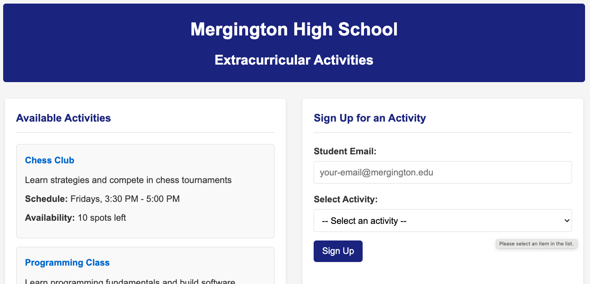
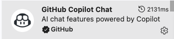
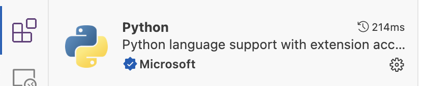
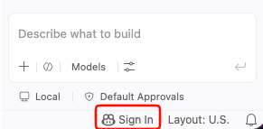
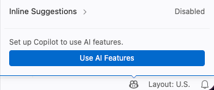
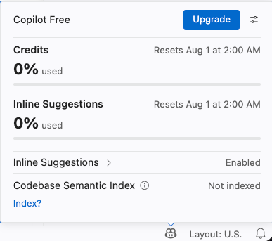
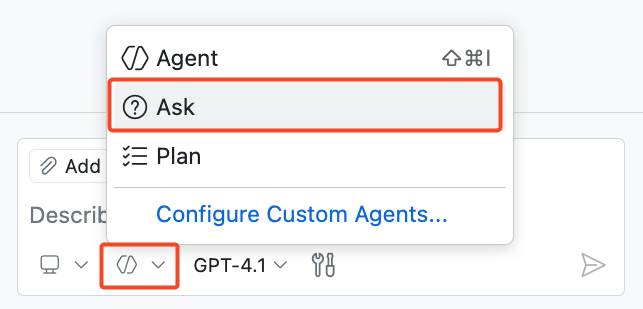
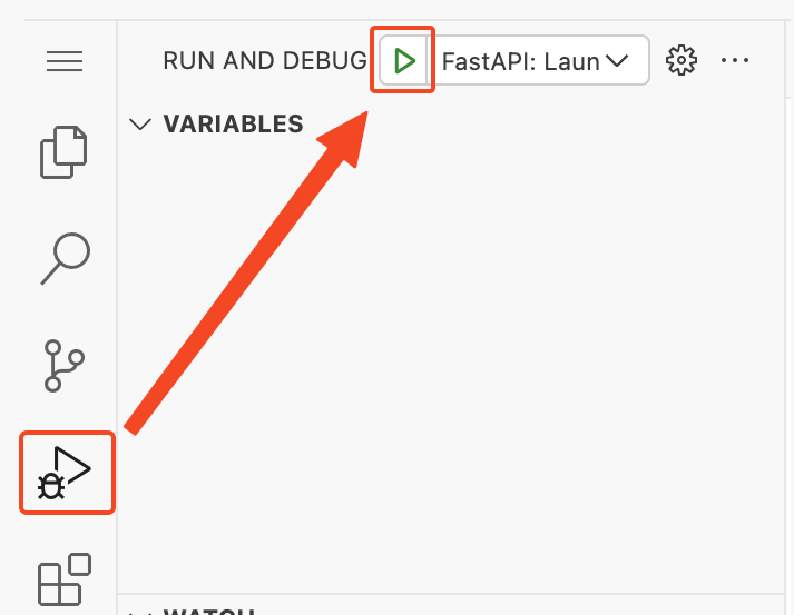
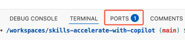

## Étape 1 : Bonjour Copilot

Bienvenue dans votre exercice **« Premiers pas avec GitHub Copilot »** ! :robot:

Dans cet exercice, vous utiliserez différentes fonctionnalités de GitHub Copilot pour travailler sur un site qui permet aux élèves du lycée de Mergington de s’inscrire à des activités extrascolaires. 🎻 ⚽️ ♟️



### 📖 Théorie : découvrir GitHub Copilot


GitHub Copilot est un assistant de programmation basé sur l’IA qui vous aide à écrire du code plus rapidement et avec moins d’efforts, afin que vous puissiez vous concentrer davantage sur la résolution de problèmes et la collaboration.

Des études ont montré que GitHub Copilot augmente la productivité des développeurs et accélère le développement logiciel. Pour en savoir plus, consultez [l’étude sur l’impact de GitHub Copilot sur la productivité et le bien-être des développeurs](https://github.blog/news-insights/research/research-quantifying-github-copilots-impact-on-developer-productivity-and-happiness/).

Dans votre IDE, vous utiliserez le plus souvent GitHub Copilot de la manière suivante :

| Interaction Mode          | 📝 Description                                                                                                                 | 🎯 Best For                                                                                                     |
| ------------------------- | ------------------------------------------------------------------------------------------------------------------------------ | --------------------------------------------------------------------------------------------------------------- |
| **⚡ Suggestions inline** | Suggestions de code générées par l’IA qui apparaissent pendant la saisie et proposent des complétions adaptées au contexte, d’une ligne à des fonctions entières. | Compléter la ligne actuelle, voire un bloc complet de code |
| **💭 Chat inline**        | Chat interactif limité au fichier ou à la sélection actuelle. Posez des questions sur des blocs de code précis. | Explications du code, débogage de fonctions et améliorations ciblées |
| **💬 Mode Ask**           | Optimisé pour répondre aux questions sur votre base de code, la programmation et les concepts technologiques. | Comprendre le fonctionnement du code, trouver des idées et poser des questions |
| **🤖 Mode Agent**         | Mode recommandé pour la plupart des tâches : modifications autonomes, utilisation d’outils et suivi jusqu’à la fin de la tâche. | Tâches quotidiennes, des corrections ciblées aux implémentations multi-fichiers |
| **🧭 Agent de planification** | Optimisé pour rédiger un plan et poser des questions de clarification avant toute modification du code. | Lorsque vous souhaitez valider un plan avant de passer à l’implémentation |

Vous découvrirez que GitHub Copilot peut vous aider à plusieurs endroits sur le site `github.com` et dans vos environnements de développement préférés, comme VS Code, JetBrains et Xcode !

For today's coding though, we will practice with VS Code in a pre-configured development environment known as a [GitHub Codespace](https://github.com/features/codespaces).

> [!TIP]
> You can learn more about current and upcoming features in the [GitHub Copilot Features](https://docs.github.com/en/copilot/about-github-copilot/github-copilot-features) documentation.

### :keyboard: Activité : demander à Copilot Chat de présenter le projet

Commençons par démarrer notre environnement de développement, utilisons Copilot pour découvrir le projet, puis exécutons-le pour faire un essai.

1. Utilisez le bouton ci-dessous pour ouvrir la page **Créer un Codespace** dans un nouvel onglet. Utilisez la configuration par défaut.

   [](https://codespaces.new/{{full_repo_name}}?quickstart=1)

1. Vérifiez que le champ **Repository** contient votre copie de l’exercice et non l’original, puis cliquez sur le bouton vert **Create Codespace**.
   - ✅ Votre copie : `/{{full_repo_name}}`
   - ❌ Original : `/skills/getting-started-with-github-copilot`

1. Attendez quelques instants que Visual Studio Code se charge dans votre navigateur.
1. Dans la barre latérale gauche, cliquez sur l’onglet des extensions et vérifiez que les extensions `GitHub Copilot Chat` et `Python` sont installées et activées.

   

   

   <details>
   <summary>🔎 L’extension GitHub Copilot Chat est absente ❓</summary>

   Si l’extension GitHub Copilot Chat est absente, vérifiez que vous êtes connecté à GitHub Copilot. Repérez l’icône **GitHub Copilot** en bas à droite de la fenêtre VS Code.

   | Status bar icon                                                                                                         | Sign in required                                                                                         | Copilot active                                                                                                  |
   | ----------------------------------------------------------------------------------------------------------------------- | -------------------------------------------------------------------------------------------------------- | --------------------------------------------------------------------------------------------------------------- |
   |  |  |  |

   Vous devriez pouvoir continuer, même si l’extension n’apparaît toujours pas dans l’onglet des extensions.

   </details>

1. En haut de VS Code, repérez et cliquez sur l’icône **Afficher/masquer le chat** pour ouvrir le panneau latéral Copilot Chat.

   

   > 🪧 **Note:** If this is your first time using GitHub Copilot, you may need to accept the usage terms to continue.


1. Pour notre première interaction, vérifiez que vous êtes en **mode Ask**.

   

1. Saisissez le prompt ci-dessous pour demander à Copilot de vous présenter le projet.

   > 
   >
   > ```prompt
   > Please briefly explain the structure of this project.
   > What should I do to run it?
   > ```

   > 🪧 **Remarque :** Il n’est pas nécessaire de suivre les instructions recommandées par Copilot. Nous avons déjà préparé l’environnement pour vous.

1. Maintenant que nous connaissons mieux le projet, essayons de l’exécuter ! Dans la barre latérale gauche, sélectionnez l’onglet `Run and Debug`, puis cliquez sur l’icône **Start Debugging**.

   

1. Nous voulons voir notre page web dans un navigateur. Trouvons donc l’URL et le port. S’ils ne sont pas visibles, développez le panneau inférieur et sélectionnez l’onglet **Ports**.

1. Dans la liste, trouvez le port `8000` et le lien associé. Survolez le lien et sélectionnez l’icône **Open in browser**.

   

### :keyboard: Activité : utiliser Copilot pour retrouver une commande du terminal 🙋

Excellent travail ! Maintenant que nous connaissons l’application et savons qu’elle fonctionne, demandons à Copilot de nous aider à créer une branche pour la personnaliser.

1. Dans le panneau inférieur de VS Code, sélectionnez l’onglet **Terminal**, puis cliquez sur le signe plus `+` à droite pour créer une nouvelle fenêtre de terminal.

   > 🪧 **Remarque :** Cela évitera d’arrêter la session de débogage qui héberge notre application web.

1. Dans la nouvelle fenêtre du terminal, utilisez le raccourci `Ctrl + I` (Windows) ou `Cmd + I` (Mac) pour ouvrir le **chat inline du terminal de Copilot**.

1. Demandons à Copilot de nous rappeler une commande oubliée : créer une branche et la publier.

   > 
   >
   > ```prompt
   > Hey copilot, how can I create and publish a new Git branch called "accelerate-with-copilot"?
   > ```

   > 💡 **Tip:** If Copilot doesn't give you quite what you want, you can always continue explaining what you need. Copilot will remember the conversation history for follow-up responses.

1. Cliquez sur le bouton `Run` pour laisser Copilot insérer la commande dans le terminal. Inutile de copier-coller !

1. Après quelques instants, regardez la barre d’état inférieure de VS Code, à gauche, pour voir la branche active. Elle doit afficher `accelerate-with-copilot`. Si c’est le cas, cette étape est terminée !

1. Maintenant que votre branche est publiée sur GitHub, Mona devrait déjà vérifier votre travail. Patientez et surveillez les commentaires : elle vous donnera des informations sur votre progression et la prochaine leçon.

<details>
<summary>Having trouble? 🤷</summary><br/>

Si vous ne recevez pas de retour, vérifiez les points suivants :

- Vérifiez que vous avez créé la branche avec le nom exact `accelerate-with-copilot`, sans préfixe ni suffixe.
- Vérifiez que la branche a bien été publiée dans votre dépôt.

</details>
