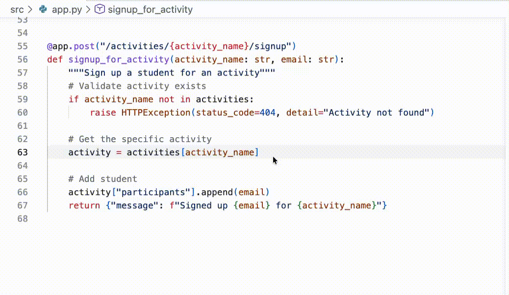
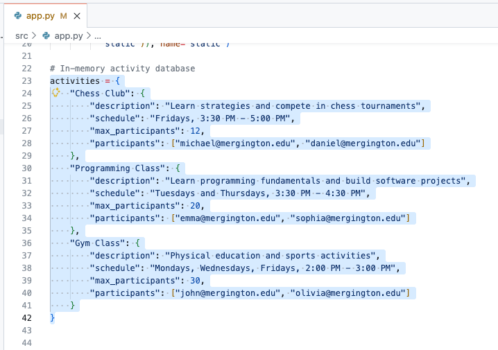
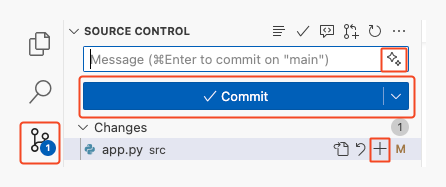

## Étape 2 : travailler avec Copilot

À l’étape précédente, GitHub Copilot nous a aidés à prendre en main le projet. C’est déjà un gain de temps considérable, mais passons maintenant à l’action !

:bug: **IL Y A UN BUG SUR LE SITE** :bug:

Nous avons découvert un problème dans le parcours d’inscription.
Les élèves peuvent actuellement s’inscrire **plus d’une fois** à la même activité ! Voyons comment Copilot peut nous aider à trouver la cause et à élaborer une correction propre.

Avant de commencer, voici un bref aperçu du fonctionnement de Copilot. 🧑‍🚀

### 📖 Théorie : comment fonctionne Copilot

En résumé, vous pouvez considérer Copilot comme un collègue très spécialisé. Pour bien travailler avec lui, vous devez fournir du contexte et des consignes claires (des prompts). De plus, les modèles ont chacun leurs points forts.

- **Comment fournir du contexte ?** Dans notre environnement de développement, Copilot prend automatiquement en compte le code voisin et les onglets ouverts. Dans le chat, vous pouvez aussi référencer explicitement des fichiers.

- **Quel modèle choisir ?** Pour cet exercice, cela n’a pas beaucoup d’importance. Tester différents modèles fait partie de l’expérience ! C’est une autre leçon à retenir ! 🤖

- **Comment rédiger des prompts ?** Des consignes explicites et claires aident Copilot à fournir de meilleurs résultats. Vous pouvez toujours préciser votre demande avec des prompts de suivi.

> [!TIP]
> There several other ways to supplement Copilot's knowledge and capabilities like [chat participants](https://docs.github.com/en/copilot/using-github-copilot/copilot-chat/github-copilot-chat-cheat-sheet?tool=vscode#chat-participants), [chat variables](https://docs.github.com/en/copilot/using-github-copilot/copilot-chat/github-copilot-chat-cheat-sheet?tool=vscode#chat-variables), [slash commands](https://docs.github.com/en/copilot/using-github-copilot/copilot-chat/github-copilot-chat-cheat-sheet?tool=vscode#slash-commands-1), and [MCP tools](https://code.visualstudio.com/docs/copilot/chat/mcp-servers).

### :keyboard: Activité : utiliser Copilot pour corriger notre bug d’inscription :bug:

1. Let's ask Copilot to suggest where our bug might be coming from. Open the **Copilot Chat** panel in **Ask mode** and ask the following.

   > 
   >
   > ```prompt
   > #codebase Students are able to register twice for an activity.
   > Where could this bug be coming from?
   > ```

1. Now that we know the issue is in the `src/app.py` file and the `signup_for_activity` method, let's follow Copilot's recommendation and go fix it (semi-manually). We'll start with a comment and let Copilot finish the correction.
   1. Open the `src/app.py` file.

      > 💡 **Tip:** If Copilot mentioned `src/app.py` in chat, you can click the file directly in the chat view to open it.

   1. Near the bottom of the file, find the `signup_for_activity` function.

   1. Find the comment line that describes adding a student. Above this is where it seems logical to do our registration check.

   1. Enter the below comment and press enter to go to the next line. After a moment, temporary shadow text will appear with a suggestion from Copilot! Nice! :tada:

      Comment:

      ```python
      # Validate student is not already signed up
      ```

      

   1. Press `Tab` to accept Copilot's suggestion and convert the shadow text to code.

   <details>
   <summary>Example Results</summary><br/>

   Copilot is growing every day and may not always produce the same results. If you are unhappy with the suggestions, here is an example of a valid suggestion result we produced during the making of this exercise. You can use it to continue forward.

   ```python
   @app.post("/activities/{activity_name}/signup")
   def signup_for_activity(activity_name: str, email: str):
      """Sign up a student for an activity"""
      # Validate activity exists
      if activity_name not in activities:
         raise HTTPException(status_code=404, detail="Activity not found")

      # Get the activity
      activity = activities[activity_name]

      # Validate student is not already signed up
      if email in activity["participants"]:
        raise HTTPException(status_code=400, detail="Student is already signed up")

      # Add student
      activity["participants"].append(email)
      return {"message": f"Signed up {email} for {activity_name}"}
   ```

   </details>

### :keyboard: Activité : laisser Copilot générer des données d’exemple 📋

Lors du développement d’un nouveau projet, il est souvent utile de disposer de fausses données réalistes pour les tests. Copilot est très efficace pour cela. Ajoutons donc des activités d’exemple et découvrons une autre façon d’utiliser Copilot avec le **chat inline**.

Le **chat inline** et le panneau **Copilot Chat** sont similaires, mais leur portée diffère : Copilot Chat traite les questions générales, multi-fichiers ou exploratoires ; le chat inline est plus rapide pour obtenir une aide ciblée sur la ligne ou le bloc affiché.

1. Vers le début du fichier `src/app.py` (environ la ligne 23), trouvez la variable `activities`, qui contient la configuration de nos activités extrascolaires d’exemple.

1. Sélectionnez tout le dictionnaire `activities` en faisant glisser la souris du début à la fin. Cela fournira du contexte à Copilot pour le prochain prompt.

   


1. Bring up Copilot inline chat by using the keyboard command `Ctrl + I` (windows) or `Cmd + I` (mac).

   > 💡 **Tip:** Another way to bring up Copilot inline chat is: `right click` on any of the selected lines -> `Open Inline Chat`.

1. Enter the following prompt text and press enter or the **Send** button on the right.

   > 
   >
   > ```prompt
   > Add 2 more sports related activities, 2 more artistic
   > activities, and 2 more intellectual activities.
   > ```

1. Après quelques instants, Copilot commencera directement à modifier le code. Les changements seront présentés différemment afin de faciliter l’identification des ajouts et suppressions. Prenez le temps de les vérifier, puis cliquez sur **Keep**.

   <details>
   <summary>Exemple de résultat</summary><br/>

   Copilot évolue chaque jour et ne produit pas toujours les mêmes résultats. Si les suggestions ne vous conviennent pas, voici un exemple obtenu lors de la création de cet exercice.

   ```python
   # In-memory activity database
   activities = {
      "Chess Club": {
         "description": "Learn strategies and compete in chess tournaments",
         "schedule": "Fridays, 3:30 PM - 5:00 PM",
         "max_participants": 12,
         "participants": ["michael@mergington.edu", "daniel@mergington.edu"]
      },
      "Programming Class": {
         "description": "Learn programming fundamentals and build software projects",
         "schedule": "Tuesdays and Thursdays, 3:30 PM - 4:30 PM",
         "max_participants": 20,
         "participants": ["emma@mergington.edu", "sophia@mergington.edu"]
      },
      "Gym Class": {
         "description": "Physical education and sports activities",
         "schedule": "Mondays, Wednesdays, Fridays, 2:00 PM - 3:00 PM",
         "max_participants": 30,
         "participants": ["john@mergington.edu", "olivia@mergington.edu"]
      },
      "Basketball Team": {
         "description": "Competitive basketball training and games",
         "schedule": "Tuesdays and Thursdays, 4:00 PM - 6:00 PM",
         "max_participants": 15,
         "participants": []
      },
      "Swimming Club": {
         "description": "Swimming training and water sports",
         "schedule": "Mondays and Wednesdays, 3:30 PM - 5:00 PM",
         "max_participants": 20,
         "participants": []
      },
      "Art Studio": {
         "description": "Express creativity through painting and drawing",
         "schedule": "Wednesdays, 3:30 PM - 5:00 PM",
         "max_participants": 15,
         "participants": []
      },
      "Drama Club": {
         "description": "Theater arts and performance training",
         "schedule": "Tuesdays, 4:00 PM - 6:00 PM",
         "max_participants": 25,
         "participants": []
      },
      "Debate Team": {
         "description": "Learn public speaking and argumentation skills",
         "schedule": "Thursdays, 3:30 PM - 5:00 PM",
         "max_participants": 16,
         "participants": []
      },
      "Science Club": {
         "description": "Hands-on experiments and scientific exploration",
         "schedule": "Fridays, 3:30 PM - 5:00 PM",
         "max_participants": 20,
         "participants": []
      }
   }
   ```

   </details>

1. Vous pouvez maintenant consulter votre site et vérifier que les nouvelles activités sont visibles.

### :keyboard: Activité : utiliser Copilot pour décrire notre travail 💬

Bravo pour la correction du bug et l’ajout d’activités ! Validons et publions maintenant notre travail sur GitHub, toujours avec l’aide de Copilot !

1. Dans la barre latérale gauche, sélectionnez l’onglet `Source Control`.

   > 💡 **Tip:** Opening a file from the source control area will show the differences to the original rather than simply opening it.

1. Trouvez le fichier `app.py` et cliquez sur le signe `+` pour placer vos modifications dans la zone de préparation.

   

1. Au-dessus de la liste des modifications préparées, trouvez le champ **Message**, mais **n’écrivez rien** pour le moment.
   - Habituellement, vous y écririez une courte description des changements, mais Copilot peut vous aider !

1. À droite du champ **Message**, trouvez et cliquez sur le bouton **Generate Commit Message** (icône avec des étincelles).

1. Cliquez sur les boutons **Commit** puis **Sync Changes** pour publier vos modifications sur GitHub.

1. Attendez quelques instants que Mona vérifie votre travail, fournisse des commentaires et partage la prochaine leçon.

<details>
<summary>Having trouble? 🤷</summary><br/>

Si vous ne recevez pas de retour, vérifiez les points suivants :

- Vérifiez que les modifications du fichier `src/app.py` ont bien été publiées sur la branche `accelerate-with-copilot`.

</details>
