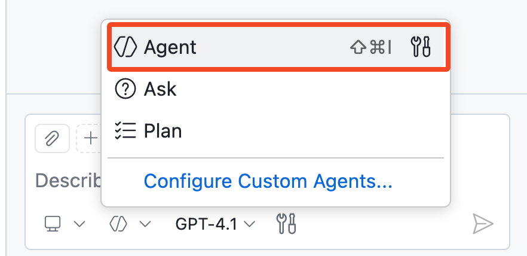
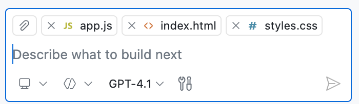
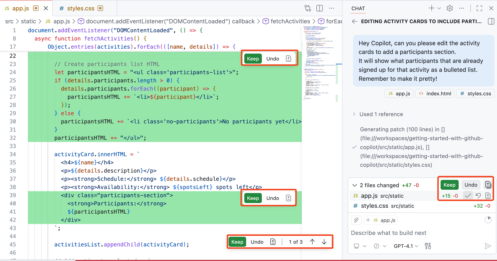
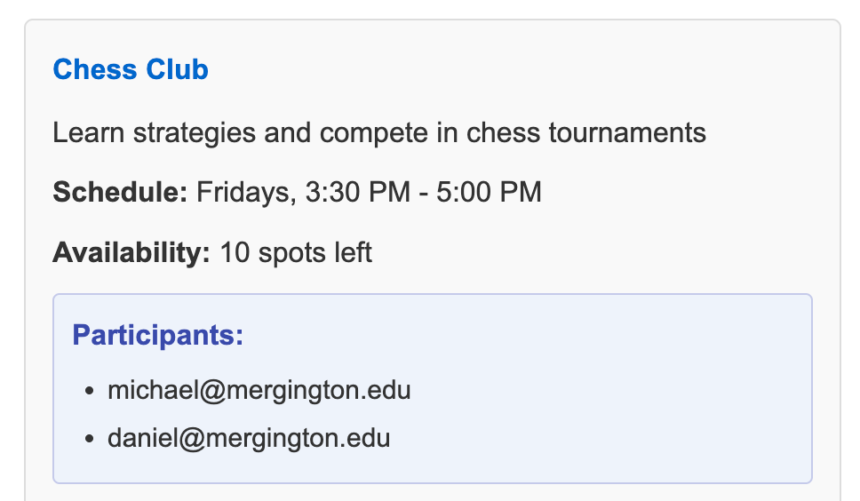
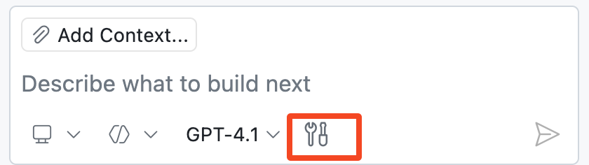

## Étape 3 : passer à la vitesse supérieure avec le mode Agent de Copilot 🚀

### 📖 Théorie : qu’est-ce que le mode Agent de Copilot ?

Le [mode Agent](https://code.visualstudio.com/docs/copilot/chat/chat-agent-mode) de Copilot est une évolution de la programmation assistée par IA. Tel un collègue programmeur autonome, il réalise des tâches de développement en plusieurs étapes à votre demande.

Le mode Agent de Copilot réagit aux erreurs de compilation et de lint, surveille la sortie du terminal et des tests, puis corrige automatiquement le code jusqu’à l’accomplissement de la tâche.

#### Le mode Agent en bref

| Aspect | 👩‍🚀 Agent Mode |
| --- | --- |
| Autonomie et planification | Décompose les demandes générales en tâches et itère jusqu’à leur réalisation. |
| Collecte du contexte | Utilise votre contexte actuel et peut découvrir d’autres fichiers pertinents si nécessaire. |
| Utilisation des outils | Sélectionne et appelle automatiquement les outils ; vous pouvez aussi les orienter avec des mentions comme `#codebase`. |
| Approbation et sécurité | Les actions sensibles peuvent nécessiter votre approbation, afin que vous gardiez le contrôle. |

#### 🧰 Outils du mode Agent

Le mode Agent utilise des outils pour réaliser des tâches spécialisées pendant le traitement d’une demande. Par exemple :

- Trouver les fichiers pertinents pour traiter votre prompt
- Récupérer le contenu d’une page web
- Exécuter des tests ou des commandes dans le terminal

> [!TIP]
> While VS Code provides many built‑in tools, you can also provide Agent Mode more domain‑specific powers through **MCP tools**.
>
> Read more on [MCP servers](https://code.visualstudio.com/docs/copilot/customization/mcp-servers) and [GitHub MCP Server](https://github.com/github/github-mcp-server)

Essayons maintenant le **mode Agent** ! 👩‍🚀

### :keyboard: Activité : utiliser Copilot pour ajouter une fonctionnalité ! :rocket:

Notre site affiche les activités, mais il garde secrète la liste des inscrits 🤫

Utilisons Copilot pour modifier le site et afficher les élèves inscrits sous chaque activité !

1. En bas de la fenêtre Copilot Chat, utilisez le menu déroulant pour passer en **mode Agent**.

   

1. Ouvrez les fichiers liés à notre page web, puis faites glisser chaque fenêtre de l’éditeur (ou chaque fichier) vers le panneau de chat, en demandant à Copilot de les utiliser comme contexte.

   - `src/static/app.js`
   - `src/static/index.html`
   - `src/static/styles.css`

   > 🪧 **Note:** Adding files as context is optional. If you skip this, Copilot Agent Mode can still use tools like `#codebase` to search for relevant files from your prompt. Adding specific files helps point Copilot in the right direction, which is especially useful in larger codebases.

   

   > 💡 **Tip:** You can also use the **Add Context...** button to provide other sources of context items, like a GitHub issue or the results of a terminal window.

1. Demandez à Copilot de mettre à jour le projet pour afficher les participants actuels des activités. Attendez quelques instants que les suggestions de modification soient proposées et appliquées.

   > 
   >
   > ```prompt
   > Hey Copilot, can you please edit the activity cards to add a participants section.
   > It will show what participants that are already signed up for that activity as a bulleted list.
   > Remember to make it pretty!
   > ```

   Une fois le travail de Copilot terminé, vous décidez quelles modifications conserver.

   Using the **Keep** buttons shown below, you can accept/discard all changes or review and decide change by change. This can be done either from the chat panel view or while inspecting each edited file.

      


1. Avant d’accepter les modifications, consultez à nouveau le site et vérifiez que tout est mis à jour comme prévu.
   
   Voici un exemple de carte d’activité mise à jour. Vous devrez peut-être redémarrer l’application ou actualiser la page.

   

   > 🪧 **Note:** Your activity card may look different. Copilot won't always produce the same results.

   <details>
   <summary>Besoin d’aide ? 🤷</summary><br/>
   Si le site ne se charge pas, vérifiez les points suivants.

   - Redémarrez le débogueur VS Code pour vous assurer que la dernière version du site est servie.
   - Si vous avez oublié l’URL ou fermé la fenêtre, consultez l’étape 1.
   - Effectuez une actualisation forcée de la page ou ouvrez-la en navigation privée pour télécharger une copie récente.

   </details>

1. Now that we have confirmed our changes are good, use the panel to cycle through each suggested edit and press **Keep** to apply the change.

   > 💡 **Tip:** You can accept the changes directly, modify them, or provide additional instruction to refine them using the chat interface.

### :keyboard: Activité : utiliser le mode Agent pour ajouter des boutons « désinscrire » fonctionnels

Expérimentons avec des demandes plus ouvertes afin d’ajouter des fonctionnalités à notre application web.

Si vous n’obtenez pas le résultat souhaité, essayez d’autres modèles ou fournissez des retours pour affiner le résultat.

1. Make sure your Copilot is still in **Agent** mode.

   

1. Cliquez sur l’icône **Outils** et explorez tous les outils actuellement disponibles pour le mode Agent de Copilot.

   

1. Passons au test ! Demandons à Copilot d’ajouter une fonctionnalité pour retirer des participants.

   > 
   >
   > ```prompt
   > #codebase Please add a delete icon next to each participant and hide the bullet points.
   > When clicked, it will unregister that participant from the activity.
   > ```

   L’outil `#codebase` permet à Copilot de trouver les fichiers et extraits de code pertinents pour la tâche.

   > 🪧 **Note:** In this lab we explicitly include the `#codebase` tool to get the most repeatable results.
   > Feel free to try the prompt **without** `#codebase` and observe whether Agent Mode decides to gather broader project context on its own.

1. Lorsque Copilot a terminé, examinez les modifications du code et le résultat sur le site. Si le résultat vous convient, cliquez sur **Keep**. Sinon, donnez un retour à Copilot pour l’affiner.

   > 🪧 **Note:** If you don't see updates on the website, you may need to restart the debugger

1. Demandez à Copilot de corriger un bug d’inscription.

   > 💡 **Tip:** We recommend testing the registration flow yourself so you can clearly see the before/after changes behavior.

   > 
   >
   > ```prompt
   > I've noticed there seems to be a bug.
   > When a participant is registered, the page must be refreshed to see the change on the activity.
   > ```

1. When Copilot is finished, inspect the results and validate the registration flow on the website.

   If you like the results, press the **Keep** button. If not, try providing Copilot some feedback.

1. **Validez** et **poussez** toutes vos modifications vers la branche `accelerate-with-copilot`.

1. Attendez que Mona vérifie votre travail et vous indique l’étape suivante.