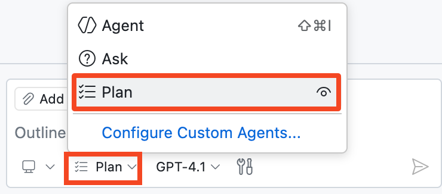
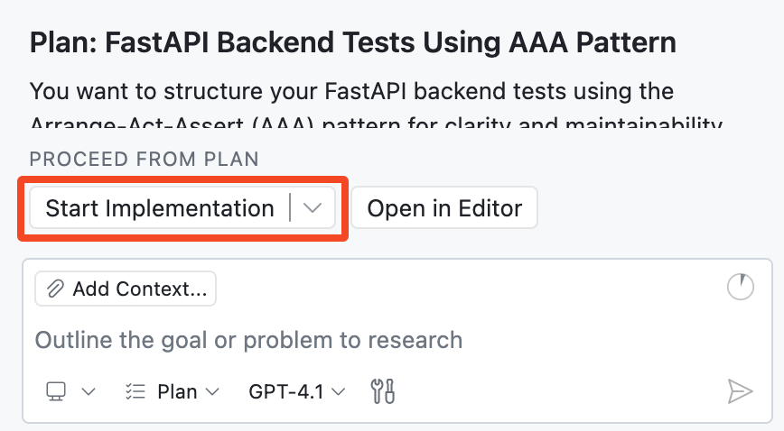

## Étape 4 : planifier votre implémentation avec l’agent de planification 🧭

À l’étape précédente, le mode Agent nous a aidés à avancer rapidement et à livrer une nouvelle fonctionnalité. 🚀

Prenons maintenant le temps de travailler comme des architectes : définissons d’abord une stratégie de test solide, puis transmettons-la pour implémentation. Nous gagnerons ainsi en clarté, avec moins de surprises et de meilleurs résultats. 🧪

### 📖 Théorie : qu’est-ce que l’agent de planification de Copilot ?

L’[agent de planification](https://code.visualstudio.com/docs/copilot/agents/planning) de Copilot vous aide à concevoir une solution avant toute modification du code.

Au lieu de modifier directement les fichiers, il étudie votre demande, pose des questions de clarification et rédige un plan d’implémentation que vous pouvez affiner.

#### L’agent de planification en bref

| Aspect | 🧭 Plan Agent |
| --- | --- |
| Objectif | Créer un plan d’implémentation structuré avant de commencer à coder. |
| Collecte du contexte | Effectuer des recherches en lecture seule pour comprendre les exigences et contraintes. |
| Collaboration | Poser des questions de clarification, puis mettre à jour le plan selon vos réponses. |
| Itération | Permettre plusieurs passes d’affinement avant l’implémentation. |
| Sécurité | Ne pas modifier les fichiers avant l’approbation du plan et le transfert au **mode Agent**. |
| Transfert | Le bouton **Démarrer l’implémentation** transmet le plan approuvé au **mode Agent** pour le codage. |

> [!TIP]
> You can start from a high-level request and then add constraints and details in follow-up prompts.

### ⌨️ Activité : planifier et implémenter les tests du backend

Votre backend n’a encore aucun test. Utilisez l’**agent de planification** pour créer un plan, répondre aux questions, puis lancer l’implémentation.

1. Ouvrez le panneau **Copilot Chat** et passez à l’**agent de planification**.

   


1. Let's start with a broad prompt and Copilot will help us fill in the details:

   > 
   >
   > ```prompt
   > Let's plan for adding backend FastAPI tests in a separate tests directory.
   > ```

1. Attendez que Copilot génère son premier plan. S’il vous pose des questions, répondez au mieux.

   > 🪧 **Note:** Don't worry about getting it perfect, you can always refine the plan later.

1. You can refine the plan and provide additional details in follow up prompts

   Here are some examples:

   > 
   >
   > ```prompt
   > Let's use the AAA (Arrange-Act-Assert) testing pattern to structure our tests
   > ```

   > 
   >
   > ```prompt
   > Make sure we use `pytest` and add it to `requirements.txt` file
   > ```


1. Examinez le plan proposé et, lorsqu’il vous convient, cliquez sur **Démarrer l’implémentation** pour le transférer au **mode Agent**.

   

   Notez qu’en cliquant sur le bouton, vous êtes passé du **mode Plan** au **mode Agent**. À partir de ce moment, Copilot peut modifier votre base de code comme précédemment.

1. Observez Copilot implémenter le plan que vous venez de créer. Il peut demander l’autorisation d’utiliser certains outils (par exemple exécuter des commandes ou créer des environnements virtuels). Accordez ces autorisations pour continuer.

1. Examinez les modifications et vérifiez que les tests s’exécutent correctement. Si nécessaire, continuez à guider Copilot jusqu’à la fin de l’implémentation.

   **🎯 Objectif : obtenir des tests tous verts avant de continuer. ✅**

   > 🪧 **Remarque :** Le mode Agent peut terminer en une seule passe ou nécessiter des prompts de suivi.

1. **Validez** et **poussez** toutes vos modifications vers la branche `accelerate-with-copilot`.

1. Attendez que Mona vérifie votre travail et vous indique l’étape suivante.

<details>
<summary>Vous rencontrez des difficultés ? 🤷</summary><br/>

- Si les tests ne se sont pas exécutés, demandez à Copilot de les lancer.
- Vérifiez que `pytest` figure dans `requirements.txt` et qu’un répertoire `tests/` existe.

</details>
