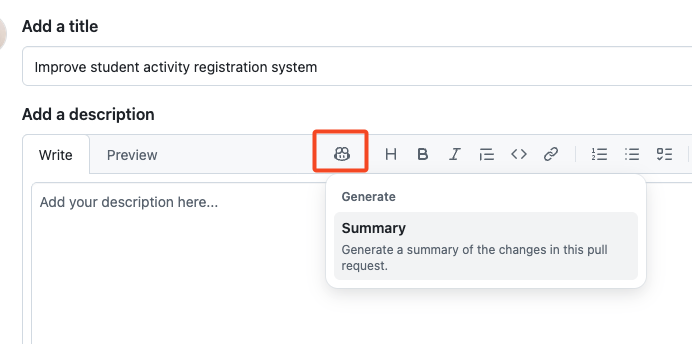
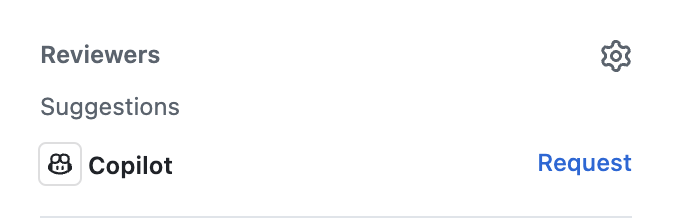

## Étape 5 : utiliser GitHub Copilot dans une pull request

Félicitations ! Vous avez terminé le codage de cet exercice (et l’utilisation de VS Code). Il est maintenant temps de fusionner notre travail. :tada: Pour conclure, découvrons deux fonctionnalités Copilot à accès limité qui peuvent accélérer nos pull requests !

### 📖 Théorie : GitHub Copilot pour les pull requests

#### Résumés de pull requests avec Copilot

Habituellement, vous relisez vos notes et vos messages de commit avant de les résumer dans la description de votre pull request. Cela peut prendre du temps, surtout si les messages sont incohérents ou si le code est mal documenté. Heureusement, Copilot peut examiner toutes les modifications de la pull request et en présenter les points importants, avec des références !

#### Revue de code avec Copilot

Un regard supplémentaire est toujours utile. Demandons donc à Copilot d’effectuer une première revue avant la revue classique par les pairs. Copilot détecte bien les erreurs courantes qui se corrigent facilement, mais utilisez-le de manière responsable.

> [!NOTE]
> Ces fonctionnalités sont uniquement disponibles avec les offres payantes de **GitHub Copilot**. [[documentation]](https://docs.github.com/en/copilot/get-started/plans)

### :keyboard: Activité : résumer et examiner une PR avec Copilot

Les **résumés de pull requests** et la **revue de code Copilot** ont un accès limité ; cette activité est donc principalement facultative. Si vous n’y avez pas accès, ignorez les étapes facultatives.

1. Dans un navigateur web, ouvrez un autre onglet et accédez au dépôt de votre exercice.

1. Une **bannière de notification** vous proposera peut-être de créer une nouvelle pull request. Cliquez dessus ou utilisez l’onglet **Pull requests** en haut pour **créer une pull request**. Utilisez les informations suivantes :

   - **base:** `main`
   - **compare:** `accelerate-with-copilot`
   - **title:** `Improve student activity registration system`

1. (Optional) In the PR description toolbar click the **Copilot** icon and **Summary** action. After a moment, Copilot will add a description based on your changes. :memo:

   

1. (Optional) In the right side information panel at the top, locate the **Reviewers** section and click the **Request** button next to a **Copilot icon**. Wait a moment for Copilot to add a review comment to your pull request!

   

   > 💡 **Tip:** Notice a log entry that Copilot was requested for a review.

1. En bas de la page, cliquez sur le bouton **Merge pull request**. Excellent travail, vous avez terminé ! :tada:

1. Attendez quelques instants que Mona vérifie votre travail, fournisse des commentaires et publie la revue finale de cet exercice !
